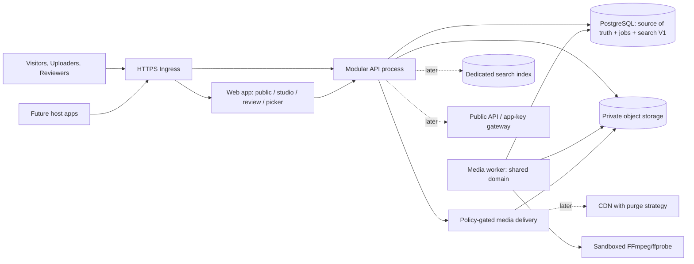

# Platform Architecture Blueprint — GIF Platform

**Document:** P3-ARCH-01 | **Version:** 0.1 | **Date:** 2026-10-15 | **Decision class:** Proposed / Provisional technical blueprint; NOT an owner-approved architecture or Scope revision.

## 0. Source Inventory — performed before architecture design

**Discovery method:** Enumerated all project-visible files and mounted paths (38/38); inspected the file/member listings of all 11 ZIP packages; extracted and read Phase 02 packages P2-WP01…P2-WP07; selected governance, Phase 02 design, and Phase 01 domain documents for content review. ZIP members include duplicated snapshots and proposed control updates; they are **not** independent approved decisions. This inventory is a current-access snapshot, not an assertion that no other files ever existed.

### 0.1 All 38 available top-level files, grouped

| Group | Located files | Use |
|---|---|---|
| Governance — 3 | `Project-Master-Roadmap.md`; `Project-Decision-Log.md`; `Project-Status.md` | Canonical 12 phases/10 systems/4 milestones; recorded DEC-001…009; currently older Phase 02 status snapshot |
| Phase 01 controls — 4 | `Research-Master-Plan-v1.md`; `Research-Execution-Protocol.md`; `Phase-01-Exit-Review.md`; `Phase-01-Formal-Closure-Package.zip` | Research method, prior exit snapshot, later formal closure (DEC-008 governs the closure outcome) |
| Phase 01 evidence — 15 | `WP-01-Product-Ecosystem-Mapping-Completed.md`; `WP-02-Actors-Roles-Account-Model-Completed.md`; `WP-03-Information-Architecture-Navigation-Completed.md`; `WP-04-Content-Discovery-Consumption-Completed.md`; `WP-05-Content-Types-Media-Model-Completed.md`; `WP-06-Content-Creation-Publishing-Completed.md`; `WP-07-Creator-Brand-Ecosystem-Completed.md`; `WP-08-Public-API-Developer-Platform-Completed.md`; `WP-09-SDKs-GIF-Picker-Integrations-Completed.md`; `WP-10-Media-Delivery-Distribution-Completed.md`; `WP-11-Content-Moderation-Trust-Safety-Completed.md`; `WP-12-Administration-Analytics-Operations-Completed.md`; `WP-13-Business-Model-Partnerships-Legal-Completed.md`; `WP-14-Unified-Capability-Requirements-Completed.md`; `WP-15-Research-Validation-Final-Synthesis-Completed.md` | Research-only domain definitions and inherited gaps, **not** GIPHY internal architecture |
| Phase 01 packages/data — 5 | `WP-14-Complete-Research-Package.zip`; `WP-15-Complete-Research-Package.zip`; `Phase-01-Missing-Deliverables-Completion.zip`; `Phase-01-Feature-Parity-Matrix.csv`; `Phase-01-Initial-PRD.md` | Original/normalized evidence, gaps, research-derived candidates, historical audit |
| Phase 02 top-level — 5 | `Phase-02-Product-Design-Master-Plan.md`; `Product-Strategy-and-Scope.md`; `Actors-Segments-and-Needs.md`; `P2-WP03-Handover.md`; `P2-WP01-Review-Package.zip` | Planning / actor / strategy inputs; P2-WP01 ZIP contains proposed governance updates |
| Phase 02 additional packages — 6 | `P2-WP02-Review-Package.zip`; `P2-WP03-Complete-Review-Package.zip`; `P2-WP04-Complete-Review-Package.zip`; `P2-WP05-Complete-Review-Package.zip`; `P2-WP06-Complete-Review-Package.zip`; `P2-WP07-Complete-Review-Package.zip` | Canonical accessible working artifacts for Scope→IA→Journeys→UX→PRD |

**Inside reviewed Phase 02 archives:** P2-WP03 contains `Scope-Register.csv`, `Product-Capability-Decision-Matrix.csv` and `P2-WP04-Handover.md`; P2-WP04 includes `Product-IA-and-Sitemap.md`; P2-WP05 includes `User-Journeys-and-Service-Flows.md`; P2-WP06 includes `UX-Specifications.md`, acceptance and media-axis registers; P2-WP07 includes `Product-PRD-v1.md`, `Working-Scope-Baseline.md/.csv`, `Requirements-Register.csv`, `Media-State-Axis-Register.csv`, `Business-Rules-Register.csv` and `P2-WP08-Handover.md`. The authoritative *accessible* own-product candidate PRD is the **P2-WP07 ZIP member**, **not** `Phase-01-Initial-PRD.md`.

**Availability gap:** No standalone P2-WP08 completion/validation/architecture-readiness package, Phase 02 closure report, or completed Phase 03 handover was present among the 38 top-level files or listed Phase 02 ZIP members. `P2-WP08-Handover.md` is **P2-WP07→P2-WP08**, expressly marked *not started* in its historic snapshot; it is not a Phase 03 handover. The user's current instruction expressly states **Phase 02 is accepted as a Working Baseline**; that later owner-supplied position is used for permission to proceed, **without inventing detailed approvals of 35 scope decisions or 198 PRD candidates**.

### 0.2 Selected authoritative content and source precedence

1. **Governance:** `Project-Master-Roadmap.md` (12 phases, 10 core systems, four versions); `Project-Decision-Log.md` (confirmed DEC-001…009); `Project-Status.md` (historical snapshot). Current owner's Phase 03/Working Baseline instruction supersedes only an outdated *phase status*, not unchanged recorded decisions.
2. **Phase 02 baseline:** `P2-WP07-Complete-Review-Package.zip/…/Product-PRD-v1.md`, `Working-Scope-Baseline.md/.csv`, `Business-Rules-Register.csv`, `Media-State-Axis-Register.csv`, `Requirements-Register.csv`, `P2-WP08-Handover.md`. Then P2-WP04 IA, P2-WP05 Journeys, P2-WP06 UX, P2-WP03 Scope, P2-WP01 Strategy/P2-WP02 Actors.
3. **Phase 01 technical-domain research:** WP-02 (actor dimensions); WP-05/06 (asset vs file, creation); WP-08/09 (API vs SDK vs Picker vs Host action); WP-10 (renditions, delivery), WP-11/12 (moderation vs operations), WP-13 (rights), WP-14/15 (evidence qualification). Other WP reports inventoried and consulted for ecosystem/IA/discovery.
4. **External engineering references (not product decision evidence):** current official Node.js releases, Next.js support/release notes, and FFmpeg filters documentation, checked 2026-10-15; vendor selection remains Provisional. References: https://nodejs.org/en/blog/release ; https://nextjs.org/support-policy ; https://nextjs.org/blog ; https://ffmpeg.org/ffmpeg-filters.html .

### 0.3 Known governance/version inconsistencies and resolution

| Finding | Documentary truth | Treatment for Phase 03 |
|---|---|---|
| Phase 02 status | Root `Project-Status`/`Roadmap` show Started–Planning; Phase 02 WP archives include later working material; owner now states Working Baseline accepted | Use **user-stated Working Baseline**, record root files as stale snapshots; **do not modify** governance |
| Product approval | P2-WP07 PRD internally says 198 candidates / 0 Approved; 35 SC = 20 Include / 12 Investigate / 2 Deferred / 1 Excluded, all previously provisional | Acceptance of **Working Baseline** is not silently transmuted into feature-by-feature unconditional approval |
| Phase 02 final gate | No accessible P2-WP08 closure or Phase 03 handover | Carry explicit documentation/approval gap; continue only under the user's direct Phase 03 authorization |
| Phase 01 exit | Early `Phase-01-Exit-Review.md` said Closure Blocked; DEC-008 later formally closed after remediation | Follow DEC-008; scientific Stage B remains Not Accepted |
| Product vs GIPHY | WP-14/15 are research; P2-WP07 is own-product **working** specification | Engineering proposals never labeled as proven GIPHY internals or approved product requirements |

## 1. Architecture goals, invariants and boundaries

**Goal:** ship an operational vertical slice rapidly, while preserving a coherent path to all ten canonical systems. Architectural proposals do **not** set a new MVP, launch market, exclusive Host context, supported locale, budget, scale, team size, or release schedule. The first build sequence is a *technical validation slice*, not a reordering of the four approved delivery milestones.

**Non-negotiable semantic invariants inherited from source baseline:**

- `Account ≠ Creator/Brand Channel ≠ Verification ≠ Developer Application/API Key ≠ Host user`.
- `Logical Asset ≠ Uploaded File ≠ Rendition ≠ URL ≠ Delivery success`.
- `Upload ≠ Processing ≠ Visibility ≠ Search eligibility ≠ Indexed ≠ API availability ≠ Delivered bytes` — seven independently observable *truth axes*; no single `published=true` shortcut.
- `Media rating ≠ Policy violation`; `Report ≠ Enforcement`; `Rights attestation ≠ legal clearance`; `Cache eviction ≠ rights for storage`.
- `Public API ≠ SDK ≠ Picker ≠ Host action`; Picker returns `selected|cancelled|error`, not `sent|posted`.
- `API request ≠ media load ≠ selection ≠ confirmed Host action`; telemetry only where authorized.

**Architecture preference:** a **Modular Monolith**, with deployable HTTP API and background worker using the *same domain packages*, is the simplest suitable launch architecture. It has modularity without imposing network calls, service discovery, distributed transactions or multiple databases on day one. Splitting CPU media jobs into a separate process is operational isolation, **not** a microservice. Each module owns its data writes and public interfaces; other modules use application services / domain events, not direct cross-module table mutation.

### 1.1 Conceptual topology

**Authority:** Postgres is transactional truth; object store holds bytes (not moderation authority). A search index is a materialized projection, never the authority for visibility/rights. CDN delivery and external clients are outside the trusted write boundary. Internal modules emit outbox/queue jobs as needed. Search/read/stream paths enforce access at the final authoritative layer.

## 2. Capability-domain blueprint — all major systems

| Bounded domain / system | Owns responsibilities | Public/internal boundary | Depends on / integration |
|---|---|---|---|
| **1. Public Website & Discovery** (`SC-01/02`) | Landing, query, results, asset detail, public creator identity, share reference, loading/empty/restricted | UI owns interaction, *not* content eligibility; all public retrieval through read API | Search, Catalog, Identity(public subset), Media delivery, Trust |
| **2. Accounts & Identity** (`SC-06`) | Registration/auth, sessions, principal/roles, account settings, permission evaluation | Owns credentials/session; **not** Developer keys, Channel verification, Host login | Users table, policy engine, audit events |
| **3. Creator & Content Management** (`SC-07/08/09/12`) | Creator/channel associations, asset metadata, owner manage, attribution, future collections | Uploader cannot approve own uploads; channel ≠ account; original rights remain scoped | Identity, Catalog, Upload, Moderation, Rights |
| **4. Upload & Media Processing** (`SC-04/07/14`) | Intake, accepted formats, quarantine, resource limits, state, rendition generation | Worker never sets public approval; original input isolated from serveable media | Object storage, jobs, metadata, moderation |
| **5. Storage & Delivery** (`SC-14/22`) | Private source/rendition objects, URL policy, HTTP representation, cache-control, future CDN | Serve only after policy decision; cache state not source of truth | Catalog, Trust, CDN/edge later |
| **6. Search & Indexing** (`SC-01/09`) | Tag normalization, index projection, filters, cursor/page, results | Must re-check authoritative rights/visibility; indexing ≠ eligibility | Catalog and moderation; PostgreSQL FTS V1, OpenSearch later conditionally |
| **7. Trust, Moderation & Rights** (`SC-21/23/24/30`) | Review decisions, reports, rating vs violation, takedown, claims/appeals workflows | Reviewer authorization separate from owner; decisions append audit; no assumed universal CDN purge | Identity, Catalog, distribution policy, operator UI |
| **8. Public API & Developer Portal** (`SC-16/17/27`) | Versioned public contracts, developer apps/keys, scopes, usage & errors, docs, quotas | API key authenticates *application*, not end-user; gateway filters content | Catalog/Search/Trust, Identity for portal, telemetry |
| **9. GIF Picker & SDK** (`SC-19` / `SC-18 Investigate`) | Prebuilt search/grid/preview/selection/cancel; future platform SDK wrappers | Picker selects media; Host alone sends/posts; avoid implying SDK parity | Public API read model, delivery, policy, Host bridge |
| **10. Analytics & Observability** (`SC-27/31`) | Tracing, logs, request/media/selection events, reliability; developer reports later | Separate product analytics from operational telemetry and Host consent | Emitted events, aggregations, privacy controls |
| **11. Administration & Operations** (`SC-23/31`) | Role-restricted review tools, incidents, retries, monitoring, safe support | No assumption of GIPHY internal dashboard; operator access is audited | Trust, queues, jobs, media status, Identity |

**Ten-system mapping:** #1 website; #2 Creator Studio; #3 Picker/SDK; #4 Developer Portal; #5 Identity; #6 Media Pipeline; #7 Search; #8 Public API; #9 Trust; #10 Infrastructure+Analytics. Operations are a cross-cutting domain, not an unauthorized eleventh canonical roadmap system.

## 3. Interface and data ownership rules

- **Catalog/Asset module:** asset logical ID, type, ownership, metadata, tagging and relationships. Tables owned only by Catalog (`assets`, `asset_tags`, `asset_variants` once generated; refer to slice spec for exact schema).
- **Upload module:** session/token issuance, validated received object, immutable upload receipt, quarantine object path; never grants public search entitlement.
- **Processing module:** job claims/FFmpeg, variants, technical failure classification. Owns updates to processing/delivery-readiness axes through a published application service.
- **Moderation module:** reviewer actions, policy/rights constraints, append-only decision log. Visibility change through Catalog command; search projection updated transactionally within approval/revocation command during V1.
- **Search module:** one-way projection and read paths; its dedicated engine can be introduced after evidence-based performance needs. No independent ability to publish.
- **Delivery module:** reauthorizes EVERY origin request, serves only derived safe media bytes, never accepts arbitrary S3 key from user; future CDN must propagate removals with explicit guarantees.
- **Account module:** principal and session cookies for web; developer-app credentials remain a separate dimension and module when built.
- **Analytics:** privacy-approved events via outbox/event boundary; never makes content accessible.

**Key flows:**

1. **Supply:** authenticated uploader → upload intent/quarantine → verified receipt → durable job → isolated FFmpeg → pending moderation → reviewer decision → visibility/eligibility/index/API read decisions.
2. **Consumption:** public web/picker → public query → policy-filtered result → policy-gated URL stream → user select → callback; no Host send action inferred.
3. **Rights/takedown:** authorized action → visibility/access denied in authoritative DB + projection removal → media origin refuses further requests → eventual/explicit CDN invalidation if configured. Cached client copies may remain; no instant global deletion claim.
4. **Developer (later):** developer login → app/key issuance → gateway quota/entitlement → same policy-filtered read model → picker/SDK consumer; API key never controls a human creator session.

## 4. Technology posture at platform scale (Provisional)

- **Style:** modular monolith; `web` app + `api` app + `worker` process in TypeScript; domain-isolated packages; asynchronous work durable in Postgres. Revisit microservices only with observed team, scaling, fault-isolation or compliance drivers.
- **System of record:** PostgreSQL for relational entities, audit, state and phase-one full-text search; indices and constraints near data. **No premature MongoDB/graph store/event sourcing**.
- **Media:** S3-compatible object interface, quarantine + processed private buckets, future edge/CDN on top; clean interface so local MinIO ≠ mandated production provider.
- **Search:** PostgreSQL FTS and normalized tags for first slice; later evaluate OpenSearch/Meilisearch/etc on actual corpus, ranking requirements, language analysis and load. No blanket claim of multilingual relevance.
- **Queue:** PostgreSQL `media_jobs` with `SKIP LOCKED`/leases and dedupe, *not* synchronous transcoding inside HTTP request. Consider dedicated broker only when queue performance/operability drives it.
- **Worker safety:** FFmpeg/ffprobe in constrained subprocess/container with CPU/memory/duration limits, no arbitrary URLs, network disabled, strict inputs and isolated temp working directory.
- **Deployment:** reproducible Docker images, local Docker Compose, single-origin ingress, independent worker replica/process; managed PostgreSQL and object storage later; avoid Kubernetes until justified. Credentials and privacy/security policies are gates for internet-facing production.
- **Search/CDN extraction seams:** `SearchRepository`, `MediaStorage`, `MediaDeliveryPolicy`, `JobQueue`, `IdentityProvider`, `EventPublisher` interfaces; migration by adapters, not cross-module table coupling.

## 5. Deliberately not designed in detail now

Product-wide schema for organizations/verification, monetization/ads, partner-specific distribution, cross-platform SDKs, AI ranking, live Clips, enterprise contracts, full legal workflow and complete multi-region operations. Those domains have explicit boundaries but no build-ready contracts in Phase 03: deep implementation spec is **only** the first Slice. No additional Product Research gate is implied.

## 6. Architecture acceptance / extraction triggers

| Concern | Start simple | Extract or revise only when evidence exists |
|---|---|---|
| API service boundaries | Modules inside one API | Independent deployments needed for fault domain, different security compliance, release ownership or scale |
| Search | PostgreSQL FTS | Measured latency/relevance/language limitations, data size, advanced ranking/typo tolerance |
| Jobs | PostgreSQL lease queue | Work backlog/throughput, operational retry or isolation requirements exceed DB-backed queue |
| Media edge | Policy-gated origin | Proven bandwidth and latency requirements plus compatible invalidation/signed URL design |
| Database | One PostgreSQL cluster | Verified contention, RTO/RPO, geographic/legal separation; avoid per-module DB prematurely |

**Explicit status:** Source inventory completed. Broad architecture proposed. No repo/code created, no governance file changed, no owner tech approval inferred. Next engineering artifact: `First-Buildable-Slice.md` and `First-Slice-Technical-Specification.md`.
